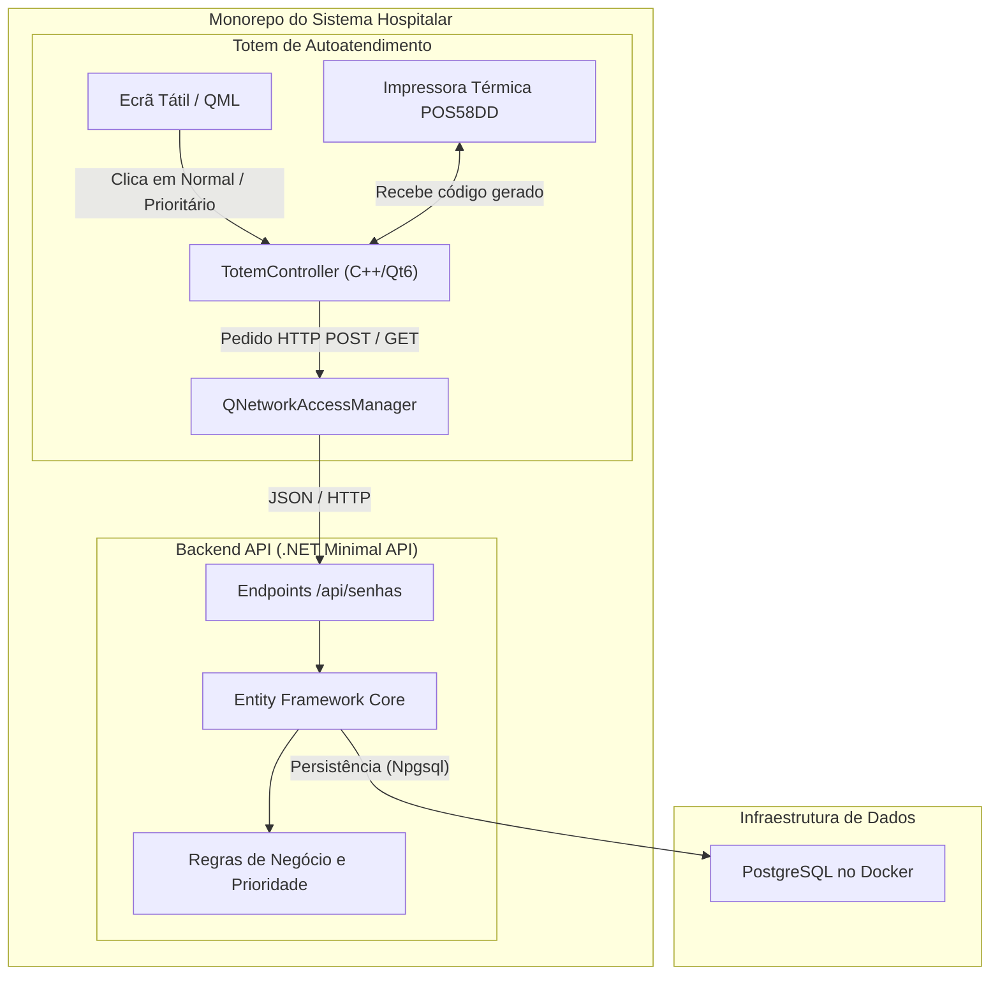

# Hospital Management System (HMS)

## Visão Geral do Projeto
O Hospital Management System é um monorepo concebido para integrar múltiplos serviços essenciais de gestão e atendimento hospitalar. O foco inicial deste projeto já consolidou o **Totem de Triagem Inteligente** (emissão de senhas físicas) e a sua respetiva **API de Backend** responsável por aplicar as regras de negócio e persistir os dados no banco de dados.

O sistema é construído com uma arquitetura moderna e em tempo real, preparando terreno para a integração do painel da receção e monitores de chamada via interfaces web (React).

---

## 📐 Arquitetura do Sistema



---

## 🛠️ Tecnologias Utilizadas

### Totem de Autoatendimento
- **Frontend UI:** Qt 6 e QML (Modo Kiosk, interface tátil)
- **Linguagem Principal:** C++ (Lógica de controlo e requisições HTTP)
- **Build System:** CMake
- **Integração de Hardware:** Impressão Térmica via `QPrinter` / `QPainter`
- **Dispositivo Alvo:** X ZHANG POS-5802DD (Impressora Térmica 58mm)

### Backend & Base de Dados
- **API Rest:** .NET (C#) Minimal API
- **ORM:** Entity Framework Core (`Npgsql.EntityFrameworkCore.PostgreSQL`)
- **Base de Dados:** PostgreSQL (Correndo em Docker)
- **Documentação da API:** Swagger / OpenAPI

---

## 🚀 Funcionalidades Implementadas (MVP - Status Atual)

### 1. Backend e Persistência (C# & PostgreSQL)
- Minimal API estruturada com endpoints REST (`POST /api/senhas`, `GET /api/senhas/espera`).
- Base de dados relacional PostgreSQL gerida via Docker.
- Criação automática de tabelas via EF Core (`EnsureCreated`).
- Lógica de geração dinâmica de senhas (ex: N-001, P-001) e suporte a fusos horários locais adaptado para o PostgreSQL (`LegacyTimestampBehavior`).

### 2. Interface do Totem (UI/QML)
- Ecrã principal interativo concebido para funcionamento em modo Kiosk (tátil).
- Teclado virtual integrado (`QtVirtualKeyboard`) com animações de transição suaves.
- Campo para introdução do CPF do paciente.
- Seleção de tipo de atendimento (Normal e Prioritário).

### 3. Integração e Comunicação (C++ ↔ C#)
- Comunicação de rede assíncrona estabelecida usando `QNetworkAccessManager`.
- O Totem envia o pedido em JSON para a API e aguarda a confirmação de gravação no banco de dados.
- Garantia de "Fonte de Verdade" (Source of Truth): O Totem não inventa números, apenas recebe o código gerado pelo backend e aciona a impressora.

### 4. Integração de Hardware (Impressão Térmica)
- Verificação em tempo real da existência e ligação da impressora instalada no sistema operativo (driver Windows).
- Impressão acionada com sucesso após retorno HTTP `200 OK` da API.
- Layout formatado via `QPainter` sem margens para papel de 58mm:
  * Cabeçalho centralizado ("HOSPITAL CENTRAL").
  * Tipo e Código da Senha retornados pela base de dados.
  * Rodapé instrutivo.

---

## 🏗️ Estrutura do Monorepo
A organização do repositório reflete uma arquitetura escalável para os próximos módulos do sistema:

```text
hospital-management-system/
│
├── .gitignore               # Configurações globais (ignora builds Qt e bin/obj do C#)
├── README.md                # Documentação central do ecossistema
│
├── TotemHospitalar/         # (Ativo) Código-fonte do Totem em C++/Qt
│   ├── CMakeLists.txt
│   ├── main.cpp
│   ├── Main.qml
│   └── totemcontroller.cpp/h
│
├── backend-api/             # (Ativo) Backend Minimal API em .NET C#
│   └── HospitalApi/
│       ├── Program.cs
│       ├── appsettings.json
│       ├── Models/
│       └── Data/
│
└── frontend-web/            # (Pendente) Painel de Gestão e Monitor TV em React
```

---

## 🔒 Segurança e Versionamento
- Repositório configurado com ligação SSH via chaves ED25519.
- O `.gitignore` global bloqueia pastas temporárias e ficheiros gerados automaticamente (`build-*/`, CMake cache, `/bin`, `/obj`), mantendo a árvore limpa e protegendo o envio acidental de ficheiros `.env`.

---

## 🔜 Próximos Passos (Roadmap)
1. **Frontend da Receção (React):** Criar o painel administrativo para os rececionistas visualizarem a lista de senhas à espera (consumindo o endpoint `GET` da API) e acionarem a chamada do próximo paciente.
2. **Monitor de TV (React & SignalR):** Desenvolver a interface para a sala de espera com atualização em tempo real e aviso sonoro quando uma senha for chamada pelo rececionista.
3. **Refinamento Visual do Talão:** Inclusão de um logótipo da instituição na impressão gráfica gerada pelo C++.
